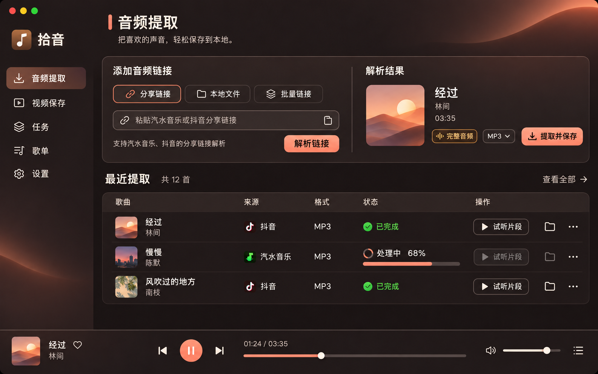

# 🎵 拾音

> 拾音是一款本地音视频工具。粘贴汽水音乐、抖音或 B 站的分享链接，或导入本地文件，即可提取音轨、剪辑片段并整理歌单。

## 立即下载

| 系统 | 下载 |
| --- | --- |
| Windows 11（x64） | [下载 Windows 版（.exe）](https://github.com/xiaoyoumi9924/shiyin/releases/latest/download/Shiyin-Windows-x64.exe) |
| macOS 13 及以上（Apple 芯片） | [下载 macOS 版（.dmg）](https://github.com/xiaoyoumi9924/shiyin/releases/latest/download/Shiyin-macOS-Apple-Silicon.dmg) |
| Debian / Ubuntu（x64） | [下载 Linux 版（.deb）](https://github.com/xiaoyoumi9924/shiyin/releases/latest/download/Shiyin-Linux-x64.deb) |

安装包内置 FFmpeg 和 FFprobe。抖音链接解析及登录窗口可使用 **Microsoft Edge 或 Google Chrome**。安装任意一个即可，Windows 优先使用 Edge。

## 安装

- **Windows** 双击 `.exe` 安装。当前安装包未签名，已核对包内容，实际 Windows 环境下的运行仍待验证。
- **macOS** 打开 `.dmg`，将「拾音」拖入「应用程序」。安装包尚未经过 Apple 公证，首次打开时如果系统提示无法验证开发者，可按 Apple 的说明在「隐私与安全性」中选择「仍要打开」。[Apple 的打开说明](https://support.apple.com/zh-cn/102445)
- **Linux** 使用系统的软件安装器打开 `.deb`，或在下载目录执行 `sudo apt install ./Shiyin-Linux-x64.deb`。安装流程已在 Debian 12 验证。

## 功能

- **音频提取**支持汽水音乐单曲和歌单、抖音视频原声、B 站视频音轨，以及本地音视频批量导入。可选择保留来源音轨，或导出 MP3、M4A。本地批量处理也支持 WAV。
- **视频保存**支持抖音和 B 站普通视频，B 站可解析分 P，保存为 MP4。
- **音频剪辑**支持波形选段、试听和淡入淡出。可编辑歌名、歌手与专辑，并嵌入可用封面。
- **歌单整理**支持收藏、自建歌单、连续播放、导出 M3U8 和可移动的歌曲文件夹。
- **任务管理**支持排队、暂停队列、重试和恢复中断任务。可分别设置音频和视频目录，也可重新关联已移动的文件。

## 使用步骤

1. **添加来源** 在「音频提取」粘贴分享链接或选择「本地文件」。批量粘贴多条分享链接或一次导入多个文件，即可批量处理。
2. **确认并保存** 解析后确认来源音质、格式和保存位置，再点「提取并保存」。只想保存视频时，切换到「视频提取」。
3. **连接账号** 如需访问账号歌单或平台授权的资源，到「设置 → 账号连接」按提示登录。在「音频提取 → 汽水音乐」打开「我的歌单」或粘贴歌单链接，再选择要保存的歌曲。
4. **查看结果** 在「任务」查看进度、播放结果或打开文件夹。在「歌单」可以收藏、整理或导出音频。文件默认保存在「音乐」文件夹下的「拾音」，可在「设置 → 文件保存」更改。

## 使用说明

- 平台返回的资源与当前账号权限决定可用音质及完整度。解析结果会区分完整音频、试听片段和完整度未知的资源。
- 账号会话、任务记录和导出文件保存在本机。在「设置 → 数据与维护」可备份和恢复记录，音视频文件需另行复制。
- 拾音为抖音使用独立浏览器配置，首次连接可在「设置 → 账号连接」打开抖音登录窗口。
- 人声与伴奏分离依赖单独配置的实验组件和模型。现有组件已在 Apple 芯片 Mac 上验证。
- 请仅处理自己有权下载与使用的内容。

## 来源与许可

拾音使用 Electron、Vue、Playwright、[FFmpeg](https://ffmpeg.org/)、LAME 和 [soda-decrypt](https://github.com/520Qiuyu/qishui-decrypt-tool)。桌面安装包的 `resources/licenses/`（macOS 为 `Contents/Resources/licenses/`）包含媒体组件的许可、构建脚本和源码归档。

从源码构建桌面版

使用 Node.js 24 或更新版本，先运行 `npm ci`。macOS 需要 Apple 芯片及 Xcode 命令行工具。在 Debian 12 x64 构建 Linux 版需要 C 工具链、`nasm`、`pkg-config`。交叉编译 Windows 媒体组件还需要 x86-64 MinGW-w64。在 Linux 打包 Windows `.exe` 需要支持 NSIS 的 Wine。

| 构建环境 | 安装包 |
| --- | --- |
| macOS arm64 | `sh scripts/build-media.sh darwin`，然后运行 `npm run desktop:pack -- darwin` |
| Linux x64 | `sh scripts/build-media.sh linux`，然后运行 `npm run desktop:pack -- linux` |
| Windows x64 | 在 Linux x64 运行 `sh scripts/build-media.sh win32`。将 `vendor/ffmpeg/win32-x64/` 放到打包工作区，再运行 `npm run desktop:pack -- win32`。此打包步骤可在 macOS 上执行。 |

安装包生成在 `release/`。

